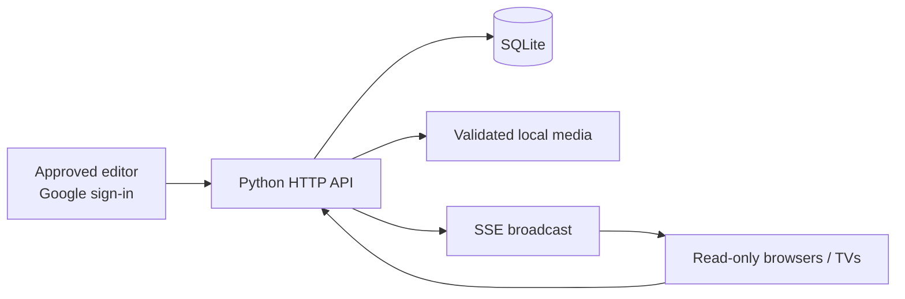

<div align="center">

# Smart Display System

**A live task board for the screens you already own.**

Self-hosted digital signage for offices, schools, labs and shared spaces. Publish tasks, announcements, images and short videos from a protected admin panel; TV and browser viewers update automatically.

   

[Getting started](#quick-start) · [Features](#features) · [Architecture](docs/architecture.mermaid) · [Requirements](docs/REQUIREMENTS.md) · [Contributing](#contributing)

</div>

> [!IMPORTANT]
> The repository is a **normal, brand-neutral application**, not a GitHub template feature. Clone it, provide your own name/logo and staff accounts, and run your own instance. Screenshots, organizational identities and deployment credentials from the original installation are not included in the current source tree.

## Why use it?

Traditional signage platforms often require extensive configuration before displaying a single announcement. Smart Display System favors a smaller workflow:

**Create an item → publish → watch it update on connected screens.**

No separate database server, no mandatory container platform, and no paid cloud service for the local viewer. Your tasks and uploaded media stay on your host.

## Features

| Feature | Status |
| --- | --- |
| Task and announcement CRUD | Available |
| Durable SQLite storage and immediate saves | Available |
| Live browser updates with SSE and reconnection | Available |
| Adaptive TV grid and automatic page rotation | Available |
| Fullscreen presentation mode | Available |
| JPEG, PNG, WebP, GIF, MP4, WebM uploads (up to 25 MiB) | Available |
| Editor sign-in via Google, server-side allowlist | Available (requires your own OAuth client) |
| Public read-only display | Available |
| Deadline validation and computed overdue status | Available; current timezone is Asia/Kuala_Lumpur |
| Day/Night themes and responsive interfaces | Available |
| Global selected weekday | Available |
| Custom uploaded logo and configurable display name | Available |
| Recurring tasks and distinct display/expiry schedule | Planned |
| Per-screen channels, playlists and remote fleet monitoring | Planned |
| Offline signage playback | Planned |

Existing and future requirements are tracked separately in [docs/REQUIREMENTS.md](docs/REQUIREMENTS.md). Do not confuse a task's **due date** with when an announcement disappears: the application currently does not have an automatic visibility end-time.

## Quick start

**Requirements:** Python 3.11+ and a modern browser. Windows, Linux and macOS can run the Python application; historical Windows-specific production automation was intentionally excluded.

```bash
git clone https://github.com/ASHRAF-2004/Smart-Display-System.git
cd Smart-Display-System
python -m venv .venv
```

Activate the virtual environment:

```bash
# Linux / macOS
source .venv/bin/activate
# Windows PowerShell: .\.venv\Scripts\Activate.ps1
```

```bash
python -m pip install -r requirements.txt
python scripts/first_run.py --site-name "My Display"
python app.py --port 8787
```

Open **http://127.0.0.1:8787/**. A new instance starts with an empty board, a neutral **YOUR LOGO** placeholder and no preauthorized staff.

### Enable editing with Google

Create a Google OAuth **Web application** client, register `http://127.0.0.1:8787` as an Authorized JavaScript origin, and run:

```bash
python scripts/first_run.py --google-client-id "YOUR_CLIENT_ID.apps.googleusercontent.com" --editor "you@example.com"
```

Use your actual verified Google account address. The browser sends Google's identity credential, the backend verifies it, and the SQLite allowlist controls editing. No Google client secret is required for this popup-based sign-in.

For a publicly hosted instance, configure a permitted HTTPS origin:

```bash
python scripts/first_run.py --public-origin "https://display.example.com"
```

Serve the loopback-bound Python origin through an HTTPS reverse proxy or tunnel. **Do not expose port 8787 directly to the internet.** Read [Setup](docs/SETUP.md) and [Security](SECURITY.md) before publishing your instance.

## How it works



Authenticated changes are checked server-side, written to SQLite, then announced over Server-Sent Events. Clients reconcile their state after reconnecting. Displays stay read-only; no admin login is required on a TV.

See the [architecture map](docs/architecture.mermaid) for selected code owners and dependency paths.

## Branding without editing source

A new instance includes a placeholder logo. An authorized Editor can upload a logo through the app. The site title can be set with `--site-name` and is stored in private instance configuration, not in tracked HTML. The default visual palette is a starting theme, not an organization identity.

Do not reuse any real organization's staff emails, data, tunnel credentials or assets. Configuration, task records and uploads belong in ignored `.data/`.

## Project layout

```text
app.py                  Python HTTP server, SQLite, SSE
security.py             Google identity, sessions, media, deadlines
index.html              Browser UI, TV view and management panels
upgrade.js              Management dialogs and adaptive TV rendering
upgrade.css             Responsive styles and themes
scripts/first_run.py    Initial instance setup
tests/                  Isolated smoke tests
docs/                   Architecture, setup, verification, requirements
.data/                  Created locally; never commit
```

## Security

Public viewers are read-only. Editor requests use validated Google identity, a database allowlist, server-side sessions, secure cookies and CSRF checks. Media is validated and served through controlled endpoints. The application listens on loopback by default. There is **no bundled staff account**.

Report potential vulnerabilities privately as described in [SECURITY.md](SECURITY.md).

## Contributing

We'd love your help with **Smart Display System**! Open an issue to report a bug or suggest a feature, or send a pull request to improve the code or docs.

See [CONTRIBUTING.md](CONTRIBUTING.md) for development setup and checks, [testing](docs/testing.md) for verification lanes, and the [architecture map](docs/architecture.mermaid) for selected layers and dependency paths.

## Roadmap

- **Next:** recurring weekday announcements, visibility start/end windows, draft/preview/publish.
- **Afterward:** independent display channels, playlists, per-screen content selection, richer searchable history.
- **Longer term:** offline player behavior, device health, media processing and advanced roles.

These are proposals, **not shipped features**. See [requirements](docs/REQUIREMENTS.md).

## License

MIT. See [LICENSE](LICENSE). Project authorship and copyright are separate from the branding configured by each installation.
